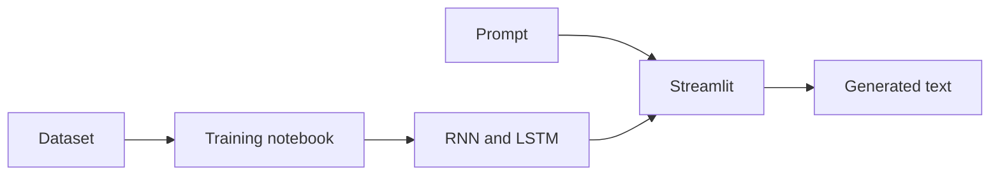

# AI Quote Generator

A Streamlit text-generation project with RNN and LSTM models. The training notebook is `LSTM.ipynb`; model weights, tokenizer and dataset are stored in the repository.

## Run locally

```bash
python -m venv .venv
# Activate the environment
pip install -r requirements.txt
streamlit run app.py
```

Use the Python version specified in `runtime.txt` where supported. Load serialized models only from trusted sources.

## Evaluation and limitations

Generated text is not a verified quotation and should not be attributed to a real person without independent verification. Compare RNN and LSTM on held-out loss, diversity and qualitative examples; no measured comparison is claimed here. Check dataset redistribution rights before publishing.

## Repository overview

Experimental RNN and LSTM text generation application with TensorFlow and Streamlit.

**Suggested GitHub topics:** `deep-learning` `text-generation` `lstm` `rnn` `tensorflow` `keras` `streamlit`.

## System architecture


